 

**Backend Developer Junior** · Cali, Colombia · Abierto a oportunidades remotas

---

## Sobre mí

Soy tecnólogo en Mecatrónica Industrial con cerca de 5 años de experiencia en mantenimiento industrial, y actualmente estudio Análisis y Desarrollo de Software en el SENA.

Estoy haciendo la transición al desarrollo de software con foco en **backend**: APIs REST con Node.js y Express, bases de datos relacionales y código organizado por capas. Mi experiencia en planta me da contexto real sobre cómo se mantienen, registran y fallan los equipos, y ese contexto es el que quiero convertir en software útil.

## Tecnologías y herramientas

<table>
  <tr>
    <td><b>Backend</b></td>
    <td></td>
    <td>JavaScript, Node.js, Express.js, APIs REST</td>
  </tr>
  <tr>
    <td><b>Bases de datos</b></td>
    <td></td>
    <td>MySQL, SQLite</td>
  </tr>
  <tr>
    <td><b>Frontend</b></td>
    <td></td>
    <td>HTML5, CSS3, React (en aprendizaje)</td>
  </tr>
  <tr>
    <td><b>Herramientas</b></td>
    <td></td>
    <td>Git, GitHub, Postman, Visual Studio Code</td>
  </tr>
</table>

## Proyectos destacados

### [Mantix](https://github.com/JuanC-32/Mantix)

API REST para la gestión de activos de mantenimiento industrial. Es el proyecto donde junto lo que hice en planta con lo que estoy aprendiendo en backend.

- Endpoints para listar, crear y actualizar parcialmente (`PATCH`) activos.
- Código separado en rutas, controladores y repositorios.
- Operaciones con transacciones sobre MySQL (`mysql2`).
- Esquema de base de datos (`schema.sql`) y configuración de Postman incluidos en el repositorio.

### [TaskFlow](https://github.com/JuanC-32/TaskFlow)

MVP de una aplicación web para que equipos remotos organicen tareas, colaboren en proyectos y midan su productividad. Lo desarrollé para una empresa ficticia, CloudSync Solutions. Es un proyecto de frontend con React y Vite, con el que estoy practicando el lado visual de las aplicaciones.

## Estadísticas de GitHub

## Actualmente aprendiendo

- React y desarrollo frontend, para poder construir aplicaciones completas.
- Diseño de bases de datos y SQL.
- Arquitectura backend y buenas prácticas de código.
- Pruebas, seguridad y despliegue de aplicaciones.

## Objetivos profesionales

- Conseguir mi primera oportunidad como desarrollador **Backend o Full Stack Junior**, de preferencia remota desde Colombia o Latinoamérica.
- Seguir construyendo proyectos documentados que resuelvan problemas reales.
- A largo plazo, combinar desarrollo de software, automatización e IoT con mi formación en mecatrónica industrial.

## Contacto

